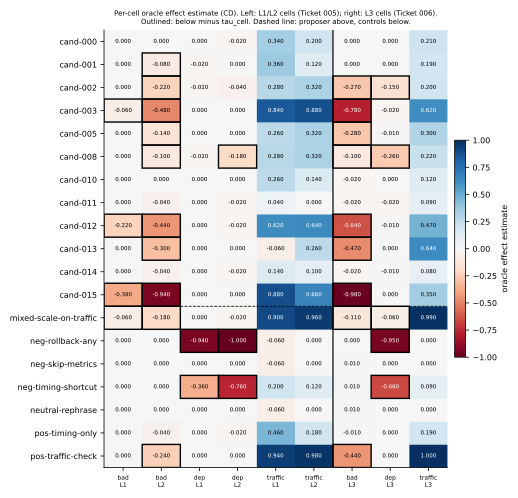
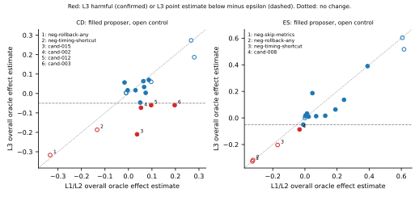

# EvidenceGate — when should a self-improving agent keep its own edits?

[](https://github.com/db-inlee/evidence-gated-self-improving-agent/actions/workflows/ci.yml)

A self-improving agent can rewrite its own procedure and then needs a rule for which edits to keep. EvidenceGate tests such admission rules in a deterministic synthetic incident world: the rules are pre-registered, the candidate edits are frozen before evaluation, and every decision is scored against a hidden root cause on held-out incidents. Three studies use it: mean-based gates, a cell-level gate (confirmatory), and an exploratory probe of harness edits.

Every number in this README is generated from committed result files, run summaries and design constants (see *Reproduce*); none was typed by hand.

## At a glance

1. **Mean-based gates** (Ticket 004 to Ticket 006). Most pre-registered questions were not supported or only partly supported (T1). In the exploratory analysis, gates that judge the mean difference admitted edits that hurt one part of the task.
2. **Cell-level gate, confirmatory** (Ticket 009, Ticket 009b). In this testbed, C4 accepted 22 proposer candidates on CD; the cell-level gate C5 filtered out 9 of them, and 9 of those 9 had Severe Local Harm. Of the 13 it kept, 2 did (one-sided Fisher p = 1/9044; RQ9-1 supported). C5 lost 0 of 7 clean Useful candidates, and admitted fewer Severe candidates than a strict mean gate that admits as many (RQ9-5 supported, p = 1/252; Severe admitted 2 against 7).
3. **Harness knob probe** (Ticket 010, exploratory). Reordering the tools, rewording a tool description and changing how tool output is shown did not change what the skill-following agent decided, in this testbed.

## Problem

An agent that edits its own skill or harness needs an admission rule: when is an edit trusted enough to keep? The obvious rules compare the edited version with the old one on some set of tasks and keep the edit if it does better. These rules can fail in at least three ways: an edit can look better on the failures it was written from and not elsewhere; it can raise the share of right answers while lowering the share of right answers reached with the required evidence; and it can raise the average while hurting a part of the task distribution. EvidenceGate measures how often simple and bootstrap-based rules keep edits that are harmful, unsupported, or harmful only in part of the task distribution.

## Design

### World and agent

- **OpsWorld.** A deterministic incident simulator. Each incident belongs to one family (`bad_deployment`, `dependency_failure`, `traffic_spike`) with a hidden root cause and one correct action (`rollback_deployment`, `observe_only`, `scale_service`). The agent sees the incident only through read-only tools (service metrics, recent deployments, dependency health, traffic) and ends the episode with a single action. Evidence predicates such as `dependency_ruled_out` are computed from the raw tool outputs observed before the action, and each action has a fixed set of required predicates. L2 incidents add family-specific distractors, and L3 incidents combine the two L2 distractors of a family in one incident. The same `(family, seed, level)` gives the same incident and tool outputs, and hidden values do not appear in any tool output.
- **Cells.** A cell is one family at one level (family × level). Results are reported overall and per cell.
- **Agent.** A local LLM (`ollama:gpt-oss:20b`, LangGraph tool loop) that follows a skill file. The initial skill S0 is deliberately imperfect: it often picks the right action without the evidence that action requires.
- **Fixed run condition.** One engine, one machine, one policy configuration (`config_id` 7c66ee5bf13c) and one tool specification for every run of the two gate studies. The harness probe changed only the harness fields, and in its wiring check P0 the tool-call limit (see its section). Each session checks these before it starts.

### Two outcomes

- **Correct Disposition (CD):** the chosen action matches the hidden root cause. This is the primary metric.
- **Evidence-Safe (ES):** CD holds *and* the evidence that action requires had been observed before acting.

### Candidate edits

- **Proposer.** An OpenAI model (gpt-5.4) sees only failed S0 episodes from Dev-A and returns one edited skill and an evidence card. Edits are machine-checked (a single change, structure, no grading terms or numbers) and deduplicated.
- **Pool.** Proposer candidates and hand-written controls with labels fixed before measurement, frozen with file hashes. The mean-gate study froze 12 proposer candidates and 7 controls; the cell-gate study froze a new pool (below).

### Splits (mean-gate study)

| Split | Incidents | Per cell | Used for |
| --- | --- | --- | --- |
| Dev-A | 60 | 10 | the proposer's input and gate C1 |
| Dev-B | 210 | 35 | gates C2–C4 and the budget curve |
| Oracle (L1/L2) | 300 | 50 | after-the-fact scoring (Ticket 005) |
| Oracle (L3) | 300 | 100 | after-the-fact scoring of the same decisions (Ticket 006) |

L1/L2 cells are family × level; L3 cells are families. The cell-gate study uses larger splits (below).

### Acceptance gates

Each gate compares a candidate with S0 on the same incidents (paired), separately for CD and ES.

| Gate | Data | Accept if |
| --- | --- | --- |
| C1 Dev-A greedy | Dev-A | candidate mean > S0 mean (ties rejected) |
| C2 keep-better | Dev-B | mean paired difference ≥ zero |
| C3 noise threshold | Dev-B | mean difference > δ(N), a high quantile of S0-vs-S0 differences (auxiliary) |
| C4 paired bootstrap | Dev-B | lower percentile of a cell-stratified paired bootstrap of the mean difference > zero, and mean difference > δ(N) |

### Oracle scoring and metrics

- **Oracle effect estimate.** Each candidate's difference from S0 on the Oracle incidents, with S0 taken as the majority of 5 runs per incident, a cell-stratified bootstrap interval (2000 draws) and per-cell differences.
- **Thresholds.** An effect counts as practically relevant beyond ε = 0.050. A per-cell threshold τ also accounts for S0 repeat noise in that cell. A candidate whose interval crosses a decision boundary is *uncertain* for that decision and is counted separately.
- **Metrics per gate:** Harmful Acceptance Rate, Unsupported Acceptance Rate, Useful Acceptance Precision, Expected Oracle Gain, False Rejection Rate and Local Harm Acceptance Rate (accepted edits with some cell estimate below minus τ). Rates come with counts and Clopper–Pearson intervals.

All verdicts and thresholds use exact rational arithmetic; Clopper–Pearson intervals are reported as floating-point numbers.

## Cell-level gate (confirmatory study)

**Why.** The mean-gate study found, as an exploratory reading, that gates that judge the mean admit edits that hurt one cell (see *Mean-based gates*, finding a). This study pre-registered a gate that also looks at cells and tested it on a new pool.

### What changed

- **C5** = C4, and every Dev-B cell difference is at least −h(n_c). h and δ come from S0-vs-S0 calibration runs (70 incidents per cell, 5 repeats), not from the oracle's τ. On CD, h(70) = 0.114 and δ(420) = 0.029.
- **C5′** = C2 with the same cell condition. **C4\*** admits as many candidates as C5: the top C4 candidates by Dev-B mean difference, with no oracle information.
- **Severe Local Harm**, the primary label: in some cell, the upper end of the oracle interval is below −τ_cell. **Clean Useful**: confirmed Useful (the lower end of the oracle interval is above ε) and not Severe.
- **Splits.** Dev-B has 420 incidents (70 per cell) and the Oracle 300 (50 per cell); Dev-A (60) is the proposer's input. S0 on the Oracle is the majority of 5 runs.

### Candidate pool

An earlier attempt (Ticket 009) stopped before any Dev-B or Oracle run: its pool reached 14 of the target 40 after 80 calls. The proposer kept repeating the same change, because the feedback list held only pooled candidates, and the duplicate rule merged edits that differ. The feedback rule and the duplicate rule were revised and pre-registered again before any new call. With 61 calls the new pool reached 40 (go threshold 25); its candidates fall into 29 idea groups.

### Fixed procedure

| Stage | Commit | What it fixes |
| --- | --- | --- |
| Earlier attempt, pre-registration | 20de478 | the gates, labels and questions (sha256 dd5f93a345bd2c9ec8bb30ad14ffaa875e80b92bea3645447de499f183dae882) |
| Calibration thresholds h and δ | 4716c65 | `results/ticket-009/thresholds.json`, sha256 d030b1734811d8a0acc8fdfd198d3d2f0b8ce87c1e81faf322e1f6b1805c3520 |
| Earlier attempt, closed | 32d6560 | the pool shortfall and the call hashes |
| Pre-registration | 12a36fd | the revised candidate generation (sha256 a4c09894f7a551e33cd592bdd769e563f0cb6aeb21ce6ba07531003852d0aa09) |
| Pool and idea groups | 4c3b532 | pool sha256 6f4a9a90f619dd8ef51f394d988d06eeb2a9c4536fb0056e2263903ba4aef239, groups sha256 c3893a7737fe9e2cc76d3b4e1c2f5ffe2f1c8804ecc95fc68798e70a14d8bcc9 |
| Run plan | 7b17c8b | sha256 4aaab082e8aa773a84c6978e4ada41ae1cf4ade69379252be05d4f7e5e9737c7 |
| Analysis code | 94fa123 | the analysis, before the main run |
| Results | adb9939 | `results/ticket-009b/analysis.json`, sha256 21c87f2798fa032e3ce627029e8b01c7629cb9b73215aeac1b3742f36d3cdafe |

### Pre-registered results

**T4. Pre-registered verdicts (proposer candidates, CD).**

| Question | Scope | Counts | Test | Verdict |
| --- | --- | --- | --- | --- |
| RQ9-1 | C4-accepted candidates: Severe Local Harm among those C5 rejects and those it keeps (one-sided Fisher test) | a 9, f 9, k 11, n 22 | p = 1/9044 | supported |
| RQ9-1 (descriptive) | the same table with the Local Harm label | a 9, f 9, k 18, n 22 | p = 13/133 | direction only |
| RQ9-2 | clean Useful C4 candidates that C5 rejects | 0 of 7 |  | supported |
| RQ9-2 (descriptive) | all Useful C4 candidates that C5 rejects | 5 of 13 |  | not supported |
| RQ9-3 | Severe among C4-accepted candidates, Clopper–Pearson interval | 11/22 | [0.282, 0.718] | supported |
| RQ9-3 (descriptive) | the same for C2 | 12/26 | [0.266, 0.666] | supported |
| RQ9-5 | C5 against the strict mean gate C4* that admits as many candidates (hypergeometric test on the set difference) | admitted 13, set difference 5, Severe in C5 only 0, in C4* only 5 | p = 1/252 | supported |
| RQ9-5 (descriptive) | count rule: Severe admitted by C5 and by C4* | C5 2, C4* 7 |  | supported |

The Fisher test asks whether the candidates C5 removed were more often Severe than those it kept; random removal would not make them so. Every Useful candidate that C5 rejected was also Severe, so C5 lost no clean Useful candidate. RQ9-5 compares C5 with C4\* inside the same C4 pool, so it is not independent evidence beside RQ9-1.

**T5. Pre-registered metrics per gate (proposer candidates, CD).**

| Gate | Accepted | Severe | Local harm | Harmful | Unsupported | Useful | Clean Useful | Gain | False rejection |
| --- | --- | --- | --- | --- | --- | --- | --- | --- | --- |
| C2 | 26 | 12/26 | 20/26 | 0/26 | 2/26 | 13/15 | 7/26 | 0.093 | 0/13 |
| C4 | 22 | 11/22 | 18/22 | 0/22 | 0/22 | 13/13 | 7/22 | 0.106 | 0/13 |
| C5 | 13 | 2/13 | 9/13 | 0/13 | 0/13 | 8/8 | 7/13 | 0.104 | 5/13 |
| C5′ | 17 | 3/17 | 11/17 | 0/17 | 2/17 | 8/10 | 7/17 | 0.084 | 5/13 |
| C4* | 13 | 7/13 | 11/13 | 0/13 | 0/13 | 11/11 | 5/13 | 0.129 | 2/13 |

C4 and C5 had almost the same mean gain (0.106 and 0.104), while C4\* reached 0.129 with 7 Severe candidates. On ES the cell condition removed nothing: C4 accepted 27 candidates and C5 accepted 27. In the mean-gate study, the same S0 had an ES rate of 0.000 on bad_deployment, where ES cannot show a regression (see *Mean-based gates*, finding c); the cell-gate result files do not report S0's ES rate per cell. ES metrics, the budget curve, h, δ, τ and the controls are in [`docs/study-2-cell-gate.md`](docs/study-2-cell-gate.md).

### Pre-registered sensitivity analysis (Section 6.6)

**T6. Cluster sensitivity (one representative per idea group).**

| Quantity | Counts | Test | Verdict |
| --- | --- | --- | --- |
| Representatives (one per idea group) | 29 |  |  |
| RQ9-1 on the representatives (sensitivity verdict) | a 6, f 6, k 7, n 14 | p = 1/429 | supported |
| RQ9-3 on the representatives (descriptive) | 7/14 | [0.230, 0.770] | supported |
| RQ9-5 on the representatives (descriptive) | admitted 8, set difference 3, Severe in C5 only 0, in C4* only 3 | p = 1/20 | direction only |
| Sensitivity verdict differs from the main verdict | no |  |  |

This is a sensitivity check, not a verdict of the study. On the representatives, RQ9-1 stays supported, and RQ9-5 is direction only.

### Run

The main run recorded 32820 episodes in 3 sessions, with 0 server errors and 0 format errors. There were 2 idle spans of at least a minute, all between sessions (0 inside a session). The longest ran from 2026-11-07T18:18:26+00:00 to 2026-11-08T08:39:44+00:00, after the session that ended with “power check failed after block 26: power: not on AC power”. On the calibration records of the mean-gate study, 575 of 600 pairs with the same seed (sequential against two concurrent episodes) chose the same disposition.

## Harness knob probe (Exploratory)

Everything in this section is exploratory. It used Dev-A only, before any pre-registration for harness edits.

P1 lists the traffic tool at the top; P2 lists dependency health before deployments; P3 and P4 add a usage note to the traffic and dependency descriptions; P5 and P6 show tool output as key-value lines and as compact JSON.

**T7. Harness knob probe on Dev-A.**

| Variant | Field | Dispositions differing from S0 | Moved | Tool set differs | Traffic tool called | Mean tool calls |
| --- | --- | --- | --- | --- | --- | --- |
| P0 | control | 60 of 60 | n/a (wiring check) | 60 | 0 | 3.000 |
| P1 | tool_order | 1 of 60 | no | 1 | 0 | 4.000 |
| P2 | tool_order | 5 of 60 | no | 5 | 0 | 4.000 |
| P3 | tool_descriptions | 5 of 60 | no | 5 | 0 | 4.000 |
| P4 | tool_descriptions | 5 of 60 | no | 5 | 0 | 4.000 |
| P5 | observation_renderer | 5 of 60 | no | 5 | 0 | 4.000 |
| P6 | observation_renderer | 3 of 60 | no | 3 | 0 | 4.000 |
| S0 | baseline (Dev-A records) |  |  |  | 0 | 4.000 |

P0 limits the agent to 3 tool calls; it checks that the harness is applied (it changed 60 of 60 dispositions) and does not count toward the decision.

No variant reached the 8 differing dispositions that counted as moving the agent. With the same seed, only 575 of 600 pairs agreed on the disposition, so a few differing episodes are expected without any change. With the traffic tool listed at the top (P1), the agent called it in 0 of 60 episodes. The decision rule was fixed before the run, but not in a pre-registration file. The next step is an environment where the harness carries more of the procedure.

## Mean-based gates (earlier study)

### Fixed procedure

Each stage was committed before the step it fixes was run. Results were added once and not modified since; the hashes below let anyone check that the files match what was committed.

| Stage | Commit | What it fixes |
| --- | --- | --- |
| Pre-registration | aa1c809 | gates, metrics, thresholds, research questions (copy sha256 7611e83ddc2204eb12f457b2caa2c93fda5bdcb0c0dd42757cc203d64818a44d) |
| Candidate pool | 7c48a6d | the proposer candidates and controls, with file hashes |
| L3 pre-registration | 49ce87d | the follow-up study (copy sha256 e368d9ed903757d9424ca5455dfcd5ce19519066bba849ef86b3b2f527f34a4b), before the Ticket 005 run |
| Analysis code | bdbecf0 | the analysis code; run plan sha256 99d4dd03a33793ce6576d753e30fbbdfc01e75e122db1d8823d4973730175b67 |
| Ticket 005 results | 38ea84e | `results/ticket-005/analysis.json`, sha256 51d51c9b01e5471e72c7927133d9f9c5732a46036d7867ba82359601e89fc982 |
| L3 analysis code | 48afcad | the L3 analysis code, before the L3 run; L3 run plan sha256 3148f16220395d3f7b7f6dd155662eddd177f5396904b08397e7b743d7077e46 |
| Ticket 006 results | 528c054 | `results/ticket-006/analysis.json`, sha256 1de4e7d3cab607a68c7e8c213e342a010ccf9d2956635b50e4fbd896d14eaa5f |
| E1 definition | 185d69c | the exploratory calculation E1 (sha256 ef70f01a73260ff814993a8cf3d52ac078c0ec8f22c10baa3975d4f7bd3b5fbd), before it was computed |

A test maps every pre-registered item and every recorded interpretation to the function that implements it and the test that checks it. The L3 analysis recomputes the Ticket 005 analysis from the same records and stops unless the result is byte-identical, so the gate decisions scored on L3 are exactly the Ticket 005 ones. The budget curve recomputes C2–C4 on stratified Dev-B subsamples of N = 24, 48, 96, 204 incidents (1000 resamples each). With 12 proposer candidates, comparisons between gates are descriptive and no tests are run.

### Pre-registered results

The research questions, as registered: RQ1 asks whether judging by CD admits edits that harm ES more often than judging by ES; RQ2 whether re-scoring on the proposer's own failure set (C1) admits more harmful and locally harmful edits than held-out gates (C2, C4), and whether the gap grows under a skewed failure set; RQ3 whether C4 admits a larger share of useful and a smaller share of harmful edits than C2, and whether the difference is larger at small budgets. RQ-L3-0 checks that L3 is harder for S0 than L1/L2; RQ-L3-1 to RQ-L3-3 re-score the same gate decisions on L3.

**T1. Pre-registered verdicts (proposer candidates).**

| Question | Scope | CD | ES |
| --- | --- | --- | --- |
| RQ1 | C2, C4: ES harm after CD vs ES acceptance | not supported |  |
| RQ2 (a) | harmful and local harm: C1 vs C2, C4 | not supported | not supported |
| RQ2 (b) | C1 gap under sensitivity resampling | does not grow | does not grow |
| RQ3 (a) | C4 vs C2 at N = 210 | not supported | partially supported |
| RQ3 trend | N from small to large | partial trend support | partial trend support |
| RQ-L3-0 | all families | manipulation not confirmed |  |
| RQ-L3-0 | bad_deployment | manipulation not confirmed |  |
| RQ-L3-0 | dependency_failure | manipulation not confirmed |  |
| RQ-L3-0 | traffic_spike | undecidable |  |
| RQ-L3-1 | harmful acceptance, C1 C2 C4 | partially supported | not supported |
| RQ-L3-2 | RQ2 (a) | not supported → partially supported (changed) | not supported → not supported (preserved) |
| RQ-L3-2 | RQ2 (b) | does not grow → does not grow (preserved) | does not grow → does not grow (preserved) |
| RQ-L3-2 | RQ3 (a) | not supported → partially supported (changed) | partially supported → partially supported (preserved) |
| RQ-L3-2 | RQ3 trend | partial trend support → trend not supported (changed) | partial trend support → trend supported (changed) |
| RQ-L3-3 | proposer labels unchanged | 5/12 | 5/12 |

RQ1 compares the two metrics and RQ-L3-0 judges S0 itself, so each has a single verdict, shown in the CD column.

On the L1/L2 oracle, no accepted proposer candidate was judged harmful under any gate, so every comparison of Harmful rates between gates was a tie, and a tie does not count as holding (a rule fixed before the analysis). On the L3 oracle, the CD Harmful rates were 1/8 for C1, 1/5 for C2 and 0/3 for C4; the harmful candidate in C1 and C2 is the same one, cand-015.

RQ-L3-0 did not confirm that L3 is harder: the S0 CD rate was 0.677 on L1/L2 and 0.663 on L3 (difference -0.013, interval [-0.027, -0.003]). The registered criterion required the difference to be below −ε = −0.050 at both ends of the interval (or the CD minus ES gap to grow by more than ε); a small drop that stays within ε does not count. As registered, the L3 results are reported as they are and the L3 definition was not changed.

The metric table per gate (T2) is in [`docs/study-1-mean-gates.md`](docs/study-1-mean-gates.md).

**T3. Local Harm Acceptance Rate (pre-registered metric, proposer candidates).**

| Gate | CD, L1/L2 cells | CD, L3 cells | CD, L1/L2 by family | ES, L1/L2 cells | ES, L3 cells | ES, L1/L2 by family |
| --- | --- | --- | --- | --- | --- | --- |
| C1 | 8/12 | 7/12 | 7/12 | 0/8 | 0/8 | 0/8 |
| C2 | 6/8 | 5/8 | 5/8 | 0/10 | 0/10 | 0/10 |
| C3 | 4/5 | 3/5 | 3/5 | 0/10 | 0/10 | 0/10 |
| C4 | 4/5 | 3/5 | 3/5 | 0/8 | 0/8 | 0/8 |

### Exploratory findings

Everything in this section was looked at after the pre-registered results were known. None of it is a test.

#### (a) Gates that judge the mean admitted locally harmful edits

*Exploratory reading of T3.* C4 accepted 5 proposer candidates on CD; on the L1/L2 oracle 4/5 of them had a cell estimate below minus τ, and on the L3 oracle 3/5 did. A gate that checks the mean difference does not look at cells, so an edit that gains in one family and loses in another can pass it (Figure F2).



*F2. Per-cell oracle effect estimates on CD. Left: L1/L2 cells; right: L3 cells. Outlined cells are below minus τ_cell. The ES version is `writeup/generated/f2_es.svg`.*

#### (b) Regressions held in one family and the L3 overall estimate

*Exploratory.* We selected candidates with the same rule as the F3 highlight: confirmed harmful on L3, or an L3 overall point estimate below −ε, on CD. Four proposer candidates meet it. cand-015 is confirmed harmful on L3 (overall estimate -0.210), while cand-002, cand-003 and cand-012 are uncertain: their L3 point estimates are below −ε (-0.073, -0.060 and -0.060) and their intervals cross −ε. For all four, the L1/L2 regression sat in the bad_deployment cells. On the L1/L2 oracle a single L2 cell carries a share of 0.167 of the incidents, while on the L3 oracle a family carries 0.333, twice as much. We do not call this a distribution shift, because RQ-L3-0 did not confirm that L3 is harder (Figure F3).



*F3. Overall oracle effect estimate on L1/L2 against L3, one point per candidate. Red: confirmed harmful on L3 or L3 point estimate below minus ε. Controls are highlighted by the same rule (open circles).*

E1 approximates the overall CD estimate if L2-like incidents made up each whole family: the mean of the three L2 cell estimates (definition fixed before computing it). It partly explains the change. E1 is closer to the L3 estimate than the L1/L2 estimate is for 10 of 12 proposer candidates, and the mean absolute residual is 0.069 for E1 against 0.093 for the L1/L2 estimate. Residuals remain, and the effect inside an L3 cell is not the same as in the matching L2 cell: for cand-003 the bad_deployment estimate moved from -0.480 (L2) to -0.780 (L3), and for cand-015 the traffic_spike estimate from 0.660 to 0.350. E1 is not the effect of cell weights alone, because the L2 cells also differ in difficulty from the L1 cells. The E1 tables are in [`docs/study-1-mean-gates.md`](docs/study-1-mean-gates.md).

#### (c) A metric with a floor at zero cannot show a regression

*Exploratory.* This is a property of the metric, illustrated by one case. Where S0's ES rate in a cell is zero, a candidate's ES difference there is at least zero, so a regression in that cell cannot appear on ES. S0's ES rate on bad_deployment was 0.000 on L1/L2 and 0.000 on L3. cand-015 is confirmed harmful on CD on L3, while its overall L3 ES estimate is 0.017 (label: neutral) and its L3 bad_deployment ES cell estimate is 0.010; the C4 gate on ES accepted it.

### Limitations of this study

- **Few candidates.** 12 proposer candidates; every rate moves in large steps and comparisons are descriptive.
- **ES floor.** S0's ES rate on bad_deployment is 0.000 on L1/L2 and 0.000 on L3, so ES cannot show a regression in that family; the same holds on traffic_spike (0.000 and 0.000), where S0's CD rate is also near zero (see exploratory finding c).
- **L3 manipulation not confirmed.** RQ-L3-0: manipulation not confirmed. S0's CD rate barely moved from L1/L2 to L3, so the L3 re-scoring cannot be read as a test under a harder distribution.
- **Noise threshold.** δ(N) resamples without cell stratification, while C4 resamples within cells.
- **Sensitivity analysis.** The skewed Dev-A resampling for RQ2 does not reproduce the actual skew of the proposer's input.
- **Idle time in the L3 run.** 19 spans of at least a minute with no episode running added up to 39945.256 s. The machine slept after the laptop lid was closed on battery power (confirmed in the macOS power-management log). No episode spanned these spans, no timeout or error was recorded in or around them, and no model reload was recorded.
- **Candidate generation.** The proposer made 16 calls; 4 candidates were excluded as duplicates by change-set similarity, which can miss duplicates that differ in wording. The earlier attempt at the cell-gate study met the opposite problem: the same rule merged edits that differ, one of the two reasons its pool stopped at 14 of 40.

## Limitations

- **One world, one policy, one S0.** All results come from one synthetic environment, one local policy model and one initial skill.
- **Same model throughout.** One model (Claude) designed the studies, grouped the candidate ideas, wrote the analysis code and wrote the reports. After the results, a fresh session without the earlier context re-applied the decision rules from the pre-registration and result files and recomputed the Severe labels from the raw records with its own code. That is the same model, not an independent reader.
- **Shared seeds.** On the Oracle, a candidate shares its LLM seed with S0's repeat zero, which is one of the S0 majority votes. The same seed does not give the same run: 575 of 600 same-seed pairs agreed on the disposition.
- **Idea groups.** Claude split the cell-gate pool into idea groups. Finer groups give more representatives, so the sensitivity check in Section 6.6 becomes less conservative.
- **Broad Local Harm.** τ_cell equals ε (0.050) in the cell-gate study, so the Local Harm label is broad: a candidate with no effect would get it with probability 0.167 (planning estimate), against 0.000475 for Severe Local Harm. This is why Severe is the primary label.
- **Rerun after a shortfall.** The cell-gate study is a second attempt. Its duplicate rule was set after reading the earlier attempt's 80 candidates, which had not been run on Dev-B or the Oracle.
- **Study-specific limits** of the mean-gate study are listed in its section.

## Related work

Averages can hide regressions in parts of the data. Oakden-Rayner et al. call this hidden stratification: a model with high overall performance can still consistently miss a rare subtype ([CHIL 2020](https://doi.org/10.1145/3368555.3384468)). Sagawa et al. show that models accurate on average can fail on particular groups, and train for the worst group with group DRO ([arXiv:1911.08731](https://arxiv.org/abs/1911.08731)). Work on model updates counts per-sample regressions between versions, the negative flips ([arXiv:2105.03048](https://arxiv.org/abs/2105.03048); [arXiv:2011.09161](https://arxiv.org/abs/2011.09161), CVPR 2021), and for hosted LLM updates, testing by risk category can find regressions that overall metrics miss ([arXiv:2604.27789](https://arxiv.org/abs/2604.27789)). The Local Harm metric applies the same concern to an agent's admission of its own edits.

Self-improving agents keep an edit after testing it in some way. The Darwin Gödel Machine validates each self-modification on coding benchmarks ([arXiv:2505.22954](https://arxiv.org/abs/2505.22954)); GEPA proposes and tests prompt updates and keeps a Pareto frontier of attempts ([arXiv:2507.19457](https://arxiv.org/abs/2507.19457)); Harness² edits a harness without ground-truth verifiers ([arXiv:2610.14224](https://arxiv.org/abs/2610.14224)); VERSE reports that optimizer self-evolution did not help without execution-based verification in a controlled study ([arXiv:2610.02616](https://arxiv.org/abs/2610.02616)); and Wei et al. separate proposal from admission and derive, under explicit assumptions, an admission rule that uses fresh validation data ([arXiv:2610.18813](https://arxiv.org/abs/2610.18813)). Yu et al. report that self-evolution can degrade previously acquired capabilities ([arXiv:2605.09315](https://arxiv.org/abs/2605.09315)). The closest work, Lin et al. ([arXiv:2609.24663](https://arxiv.org/abs/2609.24663)), tracks individual capabilities along an evolution stream at frozen checkpoints on held-out episodes and names candidate evaluation and selection as targets for improvement. EvidenceGate studies that selection step on its own: one round, a frozen pool of edits, admission rules fixed before the run, and every admission decision scored against an oracle effect estimate, overall and per cell, and separately for the right decision and for the evidence behind it.

## Future work

- **Harness edits in an external environment,** where the harness, not only the skill, carries part of the procedure.
- **Other policy models,** to see whether the cell-gate result holds beyond one local model.
- **A stronger L3,** one that is confirmed harder for S0 before the gates are re-scored.
- An ALFWorld pilot ended No-Go: the base rate was near the floor, per-cell noise was large and episodes were long. An exploratory diagnostic pointed to the missing command list as the main cause of the floor. A retry would provide the list and reduce per-cell noise, or would move to an environment with checkable evidence such as AppWorld or τ²-bench.

## Reproduce

Requires `Python 3.12` and [uv](https://docs.astral.sh/uv/). The test suite does not call an LLM or the network.

```bash
uv sync
uv run pytest
uv run ruff check . && uv run ruff format --check .
uv run mypy
```

The analysis inputs of the mean-gate study (episode records of every split, the L3 check and the session logs; 99 files, secret scan with 0 hits; the proposer's call ledger is not included) will be published as `evidencegate-records.tar.gz` once it is attached to a GitHub release of this repository. Check and unpack it at the repository root:

```bash
shasum -a 256 evidencegate-records.tar.gz   # expect 741ba9d43092be4214e6550fbc0e5ab87ad717e7618e9b338220484b034b407d
tar -xzf evidencegate-records.tar.gz        # creates runs/
```

The result files and run summaries can then be checked and the write-up values regenerated:

```bash
shasum -a 256 results/ticket-005/analysis.json results/ticket-006/analysis.json
shasum -a 256 results/ticket-009b/analysis.json results/ticket-010/probe.json   # expect 21c87f2798fa032e3ce627029e8b01c7629cb9b73215aeac1b3742f36d3cdafe and f907489e277e3e3fd3d237d5e61d71554b2f1176bf81d53d62a0bc254835158c
shasum -a 256 writeup/inputs/run_summary_009b.json                             # expect ff203e7e926de66210d5f25852fb20909830905537db22f55b4d778aa78a326f
uv run python -m evidencegate.writeup              # writeup/generated/values.json
uv run python -m evidencegate.writeup_artifacts    # tables and figures
uv run python -m evidencegate.writeup_render render # this README and the docs/ pages from their templates
uv run python -m evidencegate.writeup_render check  # numbers, keys, placement, banned phrases
```

Re-running the analyses is possible (`scripts/run_analysis.sh`, `scripts/run_l3_analysis.sh`, `uv run python -m evidencegate.t009b.analysis`), but each refuses to overwrite its result. `uv run python -m evidencegate.run_summary_009b` rebuilds the cell-gate run summary from the records and checks the pinned inputs. Re-running the policy needs a local [Ollama](https://ollama.com) server with the same model digest; the commands are in `scripts/gate_benchmark.sh` and `scripts/l3_benchmark.sh`. Displayed values are rounded half up from exact fractions, so the last digit can differ from the `float` fields in the result files.

## Layout

```
src/opsworld/       the simulator: state, generator (L1, L2, L3), tools, predicates, actions, grader
src/evidencegate/   agent policy, runners, proposer, pool, gates, oracle, metrics, analyses, write-up tools
  harness.py        harness settings: tool order, tool descriptions, observation renderers (Ticket 010)
  t009/             cell-gate study: splits, calibration thresholds, power checks, run plans, proposer entry
  t009b/            cell-gate study, revised attempt: duplicate rule, proposer entry, pool freeze, preflight, analysis
  t010/             harness knob probe runner
results/            ticket-005/, ticket-006/: mean-gate study; ticket-009/: thresholds h and delta, call manifest;
                    ticket-009b/: cell-gate study; ticket-010/: harness probe (JSON and sha256)
docs/               detailed tables of the mean-gate and cell-gate studies (rendered from writeup/)
writeup/            templates, inputs (run summaries, definitions, release manifest), generated values, tables and figures
plans/              frozen run plans and their sha256, power checks, duplicate-rule groups and properties, pool idea groups
preregistration/    pre-registered texts and their sha256: Ticket 004 section 7.8, Ticket 006 L3, Ticket 009, Ticket 009b
skills/             initial skill S0, controls and the frozen candidates (candidates/, candidates-009b/)
scripts/            run, analysis and probe scripts
tests/
```

`external/alfworld-pilot/` — Ticket 008 feasibility pilot that ports the admission-gate evaluation to ALFWorld (text mode); a separate uv project with its own lock file and tests; verdict No-Go.

All data is synthetic. No real infrastructure or incident records are used.

## License

MIT
