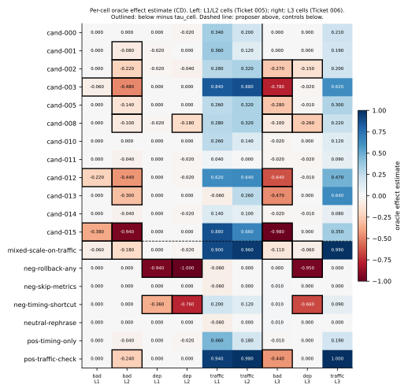
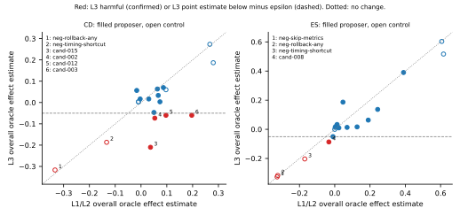

# EvidenceGate — when should a self-improving agent keep its own skill edit?

A self-improving tool-using agent can rewrite its own operating procedure: it fails, proposes an edit to its skill file (`SKILL.md`), and keeps the edit if an acceptance rule says the edit helped. EvidenceGate is a testbed for that acceptance rule. In a deterministic synthetic incident-response world where every episode is graded against a hidden root cause, we froze a pool of 12 self-proposed edits and 7 hand-written controls, pre-registered four acceptance gates and the metrics that judge them, and then re-scored every edit on held-out incidents. Table T1 lists the verdict for every pre-registered question. The exploratory findings concern edits that help on average while hurting one part of the task: gates that judge the mean admitted them, and a metric with a floor at zero hid one of them.

This README reports results. Every numeric value in it is generated from the two result files, the run summary and the design constants (see *Fixed procedure* and *Reproduce*); none was typed by hand.

## Problem

An agent that edits its own skill file needs an admission rule: when is an edit trusted enough to keep? The obvious rules compare the edited skill with the old one on some set of tasks and keep the edit if it does better. These rules can fail in at least three ways: an edit can look better on the failures it was written from and not elsewhere; it can raise the share of right answers while lowering the share of right answers reached with the required evidence; and it can raise the average while hurting a part of the task distribution. EvidenceGate measures how often each of a few simple and statistical rules keeps edits that are harmful, unsupported, or harmful only in part of the task distribution.

## Design

### World and agent

- **OpsWorld.** A deterministic incident simulator with three families (`bad_deployment`, `dependency_failure`, `traffic_spike`), each with a hidden root cause and one correct action. L2 incidents add family-specific distractors. L3 incidents combine the two L2 distractors of a family in one incident. The same `(family, seed, level)` gives the same incident and tool outputs, and hidden values do not appear in any tool output.
- **Agent.** A local LLM (`ollama:gpt-oss:20b`, LangGraph tool loop) that follows a skill file. The initial skill S0 is deliberately imperfect: it often picks the right action without the evidence that action requires.
- **Fixed run condition.** One engine, one machine, one policy configuration (`config_id` 7c66ee5bf13c) and one tool specification for every run. Each session checks these before it starts.

### Two outcomes

- **Correct Disposition (CD):** the chosen action matches the hidden root cause. This is the primary metric.
- **Evidence-Safe (ES):** CD holds *and* the evidence that action requires had been observed before acting.

### Candidate edits

- **Proposer.** An OpenAI model (gpt-5.4) sees only failed S0 episodes from Dev-A and returns one edited skill and an evidence card. Edits are machine-checked (a single change, structure, no grading terms or numbers) and deduplicated.
- **Pool.** 12 proposer candidates and 7 hand-written controls with labels fixed before measurement, frozen with file hashes.

### Splits

| Split | Incidents | Per cell | Used for |
| --- | --- | --- | --- |
| Dev-A | 60 | 10 | the proposer's input and gate C1 |
| Dev-B | 210 | 35 | gates C2–C4 and the budget curve |
| Oracle (L1/L2) | 300 | 50 | after-the-fact scoring (Ticket 005) |
| Oracle (L3) | 300 | 100 | after-the-fact scoring of the same decisions (Ticket 006) |

L1/L2 cells are family × level; L3 cells are families.

### Acceptance gates

Each gate compares a candidate with S0 on the same incidents (paired), separately for CD and ES.

| Gate | Data | Accept if |
| --- | --- | --- |
| C1 Dev-A greedy | Dev-A | candidate mean > S0 mean (ties rejected) |
| C2 keep-better | Dev-B | mean paired difference ≥ zero |
| C3 noise threshold | Dev-B | mean difference > δ(N), a high quantile of S0-vs-S0 differences (auxiliary) |
| C4 paired bootstrap | Dev-B | lower percentile of a cell-stratified paired bootstrap of the mean difference > zero, and mean difference > δ(N) |

The budget curve recomputes C2–C4 on stratified Dev-B subsamples of N = 24, 48, 96, 204 incidents (1000 resamples each).

### Oracle scoring and metrics

- **Oracle effect estimate.** Each candidate's difference from S0 on the Oracle incidents, with S0 taken as the majority of 5 runs per incident, a cell-stratified bootstrap interval (2000 draws) and per-cell differences.
- **Thresholds.** An effect counts as practically relevant beyond ε = 0.050. A per-cell threshold τ also accounts for S0 repeat noise in that cell. A candidate whose interval crosses a decision boundary is *uncertain* for that decision and is counted separately.
- **Metrics per gate:** Harmful Acceptance Rate, Unsupported Acceptance Rate, Useful Acceptance Precision, Expected Oracle Gain, False Rejection Rate and Local Harm Acceptance Rate (accepted edits with some cell estimate below minus τ). Rates come with counts and Clopper–Pearson intervals; with 12 proposer candidates, comparisons between gates are descriptive and no tests are run.

All decisions use exact rational arithmetic.

## Fixed procedure

Each stage is a commit made before the next step could reveal anything about outcomes. Results were added once and not modified since; the hashes below let anyone check that.

| Stage | Commit | What it fixes |
| --- | --- | --- |
| Pre-registration | aa1c809 | gates, metrics, thresholds, research questions (copy sha256 7611e83ddc2204eb12f457b2caa2c93fda5bdcb0c0dd42757cc203d64818a44d) |
| Candidate pool | 7c48a6d | the proposer candidates and controls, with file hashes |
| L3 pre-registration | 49ce87d | the follow-up study (copy sha256 e368d9ed903757d9424ca5455dfcd5ce19519066bba849ef86b3b2f527f34a4b), before the Ticket 005 run |
| Analysis code | bdbecf0 | the analysis code and the run plan (sha256 99d4dd03a33793ce6576d753e30fbbdfc01e75e122db1d8823d4973730175b67) |
| Ticket 005 results | 38ea84e | `results/ticket-005/analysis.json`, sha256 51d51c9b01e5471e72c7927133d9f9c5732a46036d7867ba82359601e89fc982 |
| L3 analysis code | 48afcad | the L3 analysis and run plan (sha256 3148f16220395d3f7b7f6dd155662eddd177f5396904b08397e7b743d7077e46), before the L3 run |
| Ticket 006 results | 528c054 | `results/ticket-006/analysis.json`, sha256 1de4e7d3cab607a68c7e8c213e342a010ccf9d2956635b50e4fbd896d14eaa5f |
| E1 definition | 185d69c | the exploratory calculation E1 (sha256 ef70f01a73260ff814993a8cf3d52ac078c0ec8f22c10baa3975d4f7bd3b5fbd), before it was computed |

A test maps every pre-registered item and every recorded interpretation to the function that implements it and the test that checks it. The L3 analysis recomputes the Ticket 005 analysis from the same records and stops unless the result is byte-identical, so the gate decisions scored on L3 are exactly the Ticket 005 ones.

## Pre-registered results

The research questions, as registered: RQ1 asks whether judging by CD admits edits that harm ES more often than judging by ES; RQ2 whether re-scoring on the proposer's own failure set (C1) admits more harmful and locally harmful edits than held-out gates (C2, C4), and whether the gap grows under a skewed failure set; RQ3 whether C4 admits a larger share of useful and a smaller share of harmful edits than C2, and whether the difference is larger at small budgets. RQ-L3-0 checks that L3 is harder for S0 than L1/L2; RQ-L3-1 to RQ-L3-3 re-score the same gate decisions on L3.

**T1. Pre-registered verdicts (proposer candidates).**

| Question | Scope | CD | ES |
| --- | --- | --- | --- |
| RQ1 | C2, C4: ES harm after CD vs ES acceptance | not supported |  |
| RQ2 (a) | harmful and local harm: C1 vs C2, C4 | not supported | not supported |
| RQ2 (b) | C1 gap under sensitivity resampling | does not grow | does not grow |
| RQ3 (a) | C4 vs C2 at N = 210 | not supported | partially supported |
| RQ3 trend | N from small to large | partial trend support | partial trend support |
| RQ-L3-0 | all families | manipulation not confirmed |  |
| RQ-L3-0 | bad_deployment | manipulation not confirmed |  |
| RQ-L3-0 | dependency_failure | manipulation not confirmed |  |
| RQ-L3-0 | traffic_spike | undecidable |  |
| RQ-L3-1 | harmful acceptance, C1 C2 C4 | partially supported | not supported |
| RQ-L3-2 | RQ2 (a) | not supported → partially supported (changed) | not supported → not supported (preserved) |
| RQ-L3-2 | RQ2 (b) | does not grow → does not grow (preserved) | does not grow → does not grow (preserved) |
| RQ-L3-2 | RQ3 (a) | not supported → partially supported (changed) | partially supported → partially supported (preserved) |
| RQ-L3-2 | RQ3 trend | partial trend support → trend not supported (changed) | partial trend support → trend supported (changed) |
| RQ-L3-3 | proposer labels unchanged | 5 / 12 | 5 / 12 |

On the L1/L2 oracle, no accepted proposer candidate was judged harmful under any gate, so every comparison of Harmful rates between gates was a tie, and a tie does not count as holding (a rule fixed before the analysis). On the L3 oracle, the CD Harmful rates were 1/8 for C1, 1/5 for C2 and 0/3 for C4.

RQ-L3-0 did not confirm that L3 is harder: the S0 CD rate was 0.677 on L1/L2 and 0.663 on L3 (difference -0.013, interval [-0.027, -0.003]). As registered, the L3 results are reported as they are and the L3 definition was not changed.

**T2. Pre-registered metrics per gate (proposer candidates).**

| Metric | Gate | Oracle | Accepted | Harmful | Unsupported | Useful | Gain | False rejection | Local harm |
| --- | --- | --- | --- | --- | --- | --- | --- | --- | --- |
| CD | C1 | L1/L2 | 12 | 0/12 [0.000, 0.265] | 3/12 [0.055, 0.572] | 3/5 [0.147, 0.947] | 0.061 | 0/3 [0.000, 0.708] | 8/12 [0.349, 0.901] |
| CD | C1 | L3 | 12 | 1/8 [0.003, 0.527] | 8/12 [0.349, 0.901] | 0/8 [0.000, 0.369] | -0.016 | 0/0 (undefined) | 7/12 [0.277, 0.848] |
| CD | C2 | L1/L2 | 8 | 0/8 [0.000, 0.369] | 1/8 [0.003, 0.527] | 3/3 [0.292, 1.000] | 0.084 | 0/3 [0.000, 0.708] | 6/8 [0.349, 0.968] |
| CD | C2 | L3 | 8 | 1/5 [0.005, 0.716] | 5/8 [0.245, 0.915] | 0/5 [0.000, 0.522] | -0.029 | 0/0 (undefined) | 5/8 [0.245, 0.915] |
| CD | C3 | L1/L2 | 5 | 0/5 [0.000, 0.522] | 0/5 [0.000, 0.522] | 3/3 [0.292, 1.000] | 0.103 | 0/3 [0.000, 0.708] | 4/5 [0.284, 0.995] |
| CD | C3 | L3 | 5 | 0/3 [0.000, 0.708] | 3/5 [0.147, 0.947] | 0/3 [0.000, 0.708] | 0.003 | 0/0 (undefined) | 3/5 [0.147, 0.947] |
| CD | C4 | L1/L2 | 5 | 0/5 [0.000, 0.522] | 0/5 [0.000, 0.522] | 3/3 [0.292, 1.000] | 0.103 | 0/3 [0.000, 0.708] | 4/5 [0.284, 0.995] |
| CD | C4 | L3 | 5 | 0/3 [0.000, 0.708] | 3/5 [0.147, 0.947] | 0/3 [0.000, 0.708] | 0.003 | 0/0 (undefined) | 3/5 [0.147, 0.947] |
| ES | C1 | L1/L2 | 8 | 0/8 [0.000, 0.369] | 1/8 [0.003, 0.527] | 4/6 [0.223, 0.957] | 0.137 | 0/4 [0.000, 0.602] | 0/8 [0.000, 0.369] |
| ES | C1 | L3 | 8 | 0/8 [0.000, 0.369] | 3/8 [0.085, 0.755] | 3/7 [0.099, 0.816] | 0.104 | 0/3 [0.000, 0.708] | 0/8 [0.000, 0.369] |
| ES | C2 | L1/L2 | 10 | 0/10 [0.000, 0.308] | 3/10 [0.067, 0.652] | 4/8 [0.157, 0.843] | 0.112 | 0/4 [0.000, 0.602] | 0/10 [0.000, 0.308] |
| ES | C2 | L3 | 10 | 0/10 [0.000, 0.308] | 3/10 [0.067, 0.652] | 3/8 [0.085, 0.755] | 0.089 | 0/3 [0.000, 0.708] | 0/10 [0.000, 0.308] |
| ES | C3 | L1/L2 | 10 | 0/10 [0.000, 0.308] | 3/10 [0.067, 0.652] | 4/8 [0.157, 0.843] | 0.112 | 0/4 [0.000, 0.602] | 0/10 [0.000, 0.308] |
| ES | C3 | L3 | 10 | 0/10 [0.000, 0.308] | 3/10 [0.067, 0.652] | 3/8 [0.085, 0.755] | 0.089 | 0/3 [0.000, 0.708] | 0/10 [0.000, 0.308] |
| ES | C4 | L1/L2 | 8 | 0/8 [0.000, 0.369] | 1/8 [0.003, 0.527] | 4/6 [0.223, 0.957] | 0.138 | 0/4 [0.000, 0.602] | 0/8 [0.000, 0.369] |
| ES | C4 | L3 | 8 | 0/8 [0.000, 0.369] | 2/8 [0.032, 0.651] | 3/6 [0.118, 0.882] | 0.106 | 0/3 [0.000, 0.708] | 0/8 [0.000, 0.369] |

**T3. Local Harm Acceptance Rate (pre-registered metric, proposer candidates).**

| Gate | CD, L1/L2 cells | CD, L3 cells | CD, L1/L2 by family | ES, L1/L2 cells | ES, L3 cells | ES, L1/L2 by family |
| --- | --- | --- | --- | --- | --- | --- |
| C1 | 8/12 | 7/12 | 7/12 | 0/8 | 0/8 | 0/8 |
| C2 | 6/8 | 5/8 | 5/8 | 0/10 | 0/10 | 0/10 |
| C3 | 4/5 | 3/5 | 3/5 | 0/10 | 0/10 | 0/10 |
| C4 | 4/5 | 3/5 | 3/5 | 0/8 | 0/8 | 0/8 |

## Exploratory findings

Everything in this section was looked at after the pre-registered results were known. None of it is a test.

### (a) Gates that judge the mean admitted locally harmful edits

*Exploratory reading of T3.* C4 accepted 5 proposer candidates on CD; on the L1/L2 oracle 4/5 of them had a cell estimate below minus τ, and on the L3 oracle 3/5 did. A gate that checks the mean difference does not look at cells, so an edit that gains in one family and loses in another can pass it (Figure F2).



*F2. Per-cell oracle effect estimates on CD. Left: L1/L2 cells; right: L3 cells. Outlined cells are below minus τ_cell. The ES version is `writeup/generated/f2_es.svg`.*

### (b) A regression held in one family became a negative overall estimate on L3

*Exploratory.* Four proposer candidates (cand-002, cand-003, cand-012, cand-015) had an L3 overall point estimate below minus ε on CD, and for each of them the L1/L2 regression sat in the bad_deployment cells. One of them, cand-015, is confirmed harmful on L3 (overall estimate -0.210, harmful: yes); the other three are uncertain because their intervals cross minus ε. On the L1/L2 oracle a single L2 cell carries a share of 0.167 of the incidents, while on the L3 oracle a family carries 0.333, twice as much. We do not call this a distribution shift, because RQ-L3-0 did not confirm that L3 is harder (Figure F3).



*F3. Overall oracle effect estimate on L1/L2 against L3, one point per candidate. Red: confirmed harmful on L3 or L3 point estimate below minus ε. Controls are highlighted by the same rule (open circles).*

E1 approximates the overall CD estimate if L2-like incidents made up each whole family: the mean of the three L2 cell estimates (definition fixed before computing it). It partly explains the change. E1 is closer to the L3 estimate than the L1/L2 estimate is for 10 of 12 proposer candidates, and the mean absolute residual is 0.069 for E1 against 0.093 for the L1/L2 estimate. Residuals remain, and the effect inside an L3 cell is not the same as in the matching L2 cell: for cand-003 the bad_deployment estimate moved from -0.480 (L2) to -0.780 (L3), and for cand-015 the traffic_spike estimate from 0.660 to 0.350. E1 is not the effect of cell weights alone, because the L2 cells also differ in difficulty from the L1 cells.

| Candidate | Δ L1/L2 | E1 | Δ L3 | Δ L3 − E1 | Δ L3 − Δ L1/L2 |
| --- | --- | --- | --- | --- | --- |
| cand-000 | 0.087 | 0.060 | 0.070 | 0.010 | -0.017 |
| cand-001 | 0.063 | 0.013 | 0.063 | 0.050 | 0.000 |
| cand-002 | 0.053 | 0.020 | -0.073 | -0.093 | -0.127 |
| cand-003 | 0.197 | 0.133 | -0.060 | -0.193 | -0.257 |
| cand-005 | 0.073 | 0.060 | 0.003 | -0.057 | -0.070 |
| cand-008 | 0.050 | 0.013 | -0.047 | -0.060 | -0.097 |
| cand-010 | 0.067 | 0.047 | 0.033 | -0.013 | -0.033 |
| cand-011 | -0.003 | -0.020 | 0.017 | 0.037 | 0.020 |
| cand-012 | 0.097 | 0.060 | -0.060 | -0.120 | -0.157 |
| cand-013 | -0.017 | -0.013 | 0.057 | 0.070 | 0.073 |
| cand-014 | 0.030 | 0.013 | 0.017 | 0.003 | -0.013 |
| cand-015 | 0.037 | -0.093 | -0.210 | -0.117 | -0.247 |

| Candidate | bad: L2 → L3 | dep: L2 → L3 | traffic: L2 → L3 |
| --- | --- | --- | --- |
| cand-000 | 0.000 → 0.000 | -0.020 → 0.000 | 0.200 → 0.210 |
| cand-001 | -0.080 → 0.000 | 0.000 → 0.000 | 0.120 → 0.190 |
| cand-002 | -0.220 → -0.270 | -0.040 → -0.150 | 0.320 → 0.200 |
| cand-003 | -0.480 → -0.780 | 0.000 → -0.020 | 0.880 → 0.620 |
| cand-005 | -0.140 → -0.280 | 0.000 → -0.010 | 0.320 → 0.300 |
| cand-008 | -0.100 → -0.100 | -0.180 → -0.260 | 0.320 → 0.220 |
| cand-010 | 0.000 → -0.020 | 0.000 → 0.000 | 0.140 → 0.120 |
| cand-011 | -0.040 → -0.020 | -0.020 → -0.020 | 0.000 → 0.090 |
| cand-012 | -0.440 → -0.640 | -0.020 → -0.010 | 0.640 → 0.470 |
| cand-013 | -0.300 → -0.470 | 0.000 → 0.000 | 0.260 → 0.640 |
| cand-014 | -0.040 → -0.020 | -0.020 → -0.010 | 0.100 → 0.080 |
| cand-015 | -0.940 → -0.980 | 0.000 → 0.000 | 0.660 → 0.350 |

### (c) A metric with a floor at zero cannot show a regression

*Exploratory.* This is a property of the metric, illustrated by one case. Where S0's ES rate in a cell is zero, a candidate's ES difference there is at least zero, so a regression in that cell cannot appear on ES. S0's ES rate on bad_deployment was 0.000 on L1/L2 and 0.000 on L3. cand-015 is confirmed harmful on CD on L3, while its ES estimate there is 0.017 (subset: neutral), and the C4 gate on ES accepted it (yes).

## Limitations

- **Few candidates.** 12 proposer candidates; every rate moves in large steps and comparisons are descriptive.
- **ES floor.** S0's ES rate on bad_deployment is 0.000 on L1/L2 and 0.000 on L3, which makes ES blind to disposition regressions in that family (finding c).
- **L3 manipulation not confirmed.** RQ-L3-0: manipulation not confirmed. S0's CD rate barely moved from L1/L2 to L3, so the L3 re-scoring cannot be read as a test under a harder distribution.
- **Shared seeds.** On the Oracle, a candidate shares its LLM seed with S0's repeat zero, which is one of the 5 majority votes.
- **Noise threshold.** δ(N) resamples without cell stratification, while C4 resamples within cells.
- **Sensitivity analysis.** The skewed Dev-A resampling for RQ2 does not reproduce the actual skew of the proposer's input.
- **Idle time in the L3 run.** 19 spans of at least a minute with no episode running added up to 39945.256 s (longest 6032.456 s); cause not identified; no path to the results was found. Episodes in and around these spans finished normally, and the model was not reloaded.
- **Candidate generation.** The proposer made 16 calls; 4 candidates were excluded as duplicates by change-set similarity, which can miss duplicates that differ in wording.
- **Review.** The independent review of this write-up is done by a fresh session of the same model, which is not a fully independent reader.

## Related work

EvidenceGate sits close to recent work on agents that revise their own harness and focuses on one part of that loop, the admission rule.

- **Harness²** (Xu et al., 2026, [arXiv:2610.14224](https://arxiv.org/abs/2610.14224)) evolves an agent's execution harness for open-world tasks without a ground-truth verifier, using a contrastive Propose–Probe–Compose step.
- **Self-Evolving Agent Harness** (Wei et al., 2026, [arXiv:2610.18813](https://arxiv.org/abs/2610.18813)) formalizes harness self-evolution, separates update targets from proposal and admission mechanisms, and derives, under explicit assumptions, a high-probability admission rule that uses fresh, independent validation data.
- **VERSE** (Wang et al., 2026, [arXiv:2610.02616](https://arxiv.org/abs/2610.02616)) lets a harness optimizer verify draft edits before submission and reports, in a controlled study, that optimizer self-evolution did not improve performance without execution-based verification.

EvidenceGate does not propose a new optimizer. It takes a fixed pool of self-proposed edits and measures how often simple and statistical admission rules keep edits that are harmful, unsupported, or harmful only on part of the distribution.

## Future work

- **Cell-level gates.** A gate that also requires every cell estimate on Dev-B to stay above a noise bound derived from S0-vs-S0 calibration runs (not from the oracle's τ), tested on a new candidate pool.
- **A larger, new candidate pool,** so that locally harmful candidates are frequent enough to compare gates.
- **A stronger L3,** one that is confirmed harder for S0 before the gates are re-scored.
- **An external benchmark pilot** to check whether the same failure modes appear outside OpsWorld.

## Reproduce

Requires `Python 3.12` and [uv](https://docs.astral.sh/uv/). The test suite does not call an LLM or the network.

```bash
uv sync
uv run pytest
uv run ruff check . && uv run ruff format --check .
uv run mypy
```

The analysis inputs (episode records of every split, the L3 check and the session logs; 99 files, secret scan with 0 hits; the proposer's call ledger is not included) are published as `evidencegate-records.tar.gz`, to be attached to a GitHub release of this repository. Check and unpack it at the repository root:

```bash
shasum -a 256 evidencegate-records.tar.gz   # expect 741ba9d43092be4214e6550fbc0e5ab87ad717e7618e9b338220484b034b407d
tar -xzf evidencegate-records.tar.gz        # creates runs/
```

The result files can then be checked and the write-up values regenerated:

```bash
shasum -a 256 results/ticket-005/analysis.json results/ticket-006/analysis.json
uv run python -m evidencegate.writeup              # writeup/generated/values.json
uv run python -m evidencegate.writeup_artifacts    # tables and figures
uv run python -m evidencegate.writeup_render render # this README from writeup/README.template
uv run python -m evidencegate.writeup_render check  # numbers, keys, placement, banned phrases
```

Re-running the analyses is possible (`scripts/run_analysis.sh`, `scripts/run_l3_analysis.sh`), but each refuses to overwrite its result. Re-running the policy needs a local [Ollama](https://ollama.com) server with the same model digest; the commands are in `scripts/gate_benchmark.sh` and `scripts/l3_benchmark.sh`. Displayed values are rounded half up from exact fractions, so the last digit can differ from the float formatting in `results/*/analysis.md`.

## Layout

```
src/opsworld/       the simulator: state, generator (L1, L2, L3), tools, predicates, actions, grader
src/evidencegate/   agent policy, runners, proposer, pool, gates, oracle, metrics, analyses, write-up tools
results/            the two analysis results (JSON, sha256, Markdown)
writeup/            README template, inputs (run summary, E1 definition, release manifest), generated values, tables and figures
plans/              the frozen run plans and their sha256
preregistration/    hashes and copies of the pre-registered plans
skills/             initial skill S0, controls and the frozen candidates
scripts/            run, analysis and probe scripts
tests/
```

All data is synthetic. No real infrastructure or incident records are used.

## Appendix: E1 for controls and on ES

*Exploratory.*

| Candidate | Metric | Δ L1/L2 | E1 | Δ L3 | Δ L3 − E1 | Δ L3 − Δ L1/L2 |
| --- | --- | --- | --- | --- | --- | --- |
| mixed-scale-on-traffic | CD | 0.267 | 0.253 | 0.273 | 0.020 | 0.007 |
| neg-rollback-any | CD | -0.333 | -0.333 | -0.317 | 0.017 | 0.017 |
| neg-skip-metrics | CD | -0.010 | 0.000 | 0.003 | 0.003 | 0.013 |
| neg-timing-shortcut | CD | -0.133 | -0.213 | -0.187 | 0.027 | -0.053 |
| neutral-rephrase | CD | -0.010 | 0.000 | 0.003 | 0.003 | 0.013 |
| pos-timing-only | CD | 0.097 | 0.040 | 0.060 | 0.020 | -0.037 |
| pos-traffic-check | CD | 0.280 | 0.247 | 0.187 | -0.060 | -0.093 |
| cand-000 | ES | 0.390 | 0.367 | 0.390 | 0.023 | 0.000 |
| cand-001 | ES | 0.023 | 0.000 | 0.010 | 0.010 | -0.013 |
| cand-002 | ES | -0.010 | -0.013 | -0.050 | -0.037 | -0.040 |
| cand-003 | ES | 0.070 | 0.027 | 0.013 | -0.013 | -0.057 |
| cand-005 | ES | 0.003 | 0.007 | 0.017 | 0.010 | 0.013 |
| cand-008 | ES | -0.033 | -0.060 | -0.087 | -0.027 | -0.053 |
| cand-010 | ES | 0.010 | 0.007 | 0.023 | 0.017 | 0.013 |
| cand-011 | ES | 0.013 | -0.007 | 0.033 | 0.040 | 0.020 |
| cand-012 | ES | 0.190 | 0.127 | 0.063 | -0.063 | -0.127 |
| cand-013 | ES | 0.047 | 0.093 | 0.187 | 0.093 | 0.140 |
| cand-014 | ES | 0.243 | 0.180 | 0.137 | -0.043 | -0.107 |
| cand-015 | ES | 0.127 | 0.073 | 0.017 | -0.057 | -0.110 |
| mixed-scale-on-traffic | ES | 0.607 | 0.587 | 0.603 | 0.017 | -0.003 |
| neg-rollback-any | ES | -0.323 | -0.333 | -0.317 | 0.017 | 0.007 |
| neg-skip-metrics | ES | -0.327 | -0.327 | -0.327 | 0.000 | 0.000 |
| neg-timing-shortcut | ES | -0.170 | -0.253 | -0.203 | 0.050 | -0.033 |
| neutral-rephrase | ES | 0.000 | 0.000 | 0.000 | 0.000 | 0.000 |
| pos-timing-only | ES | 0.003 | -0.007 | 0.013 | 0.020 | 0.010 |
| pos-traffic-check | ES | 0.617 | 0.573 | 0.517 | -0.057 | -0.100 |

## License

MIT
